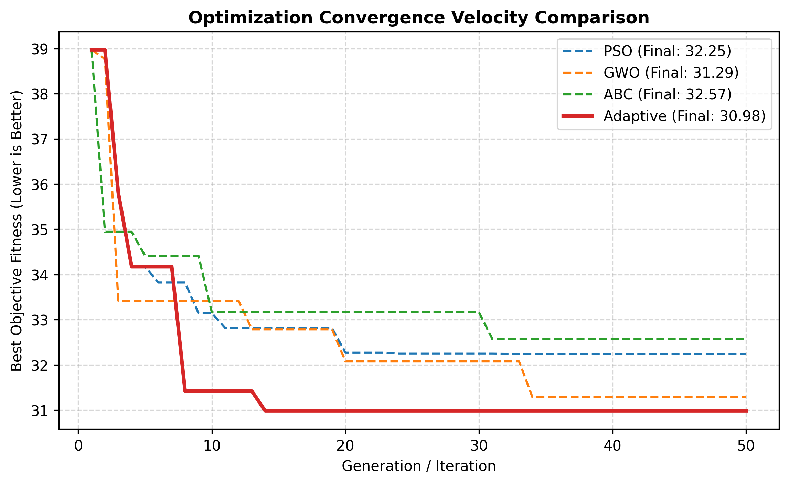
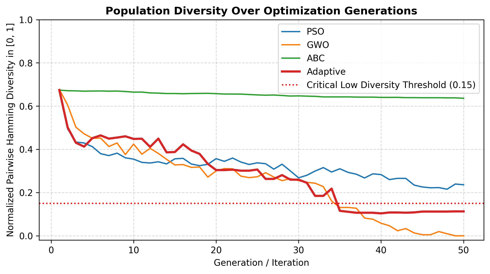
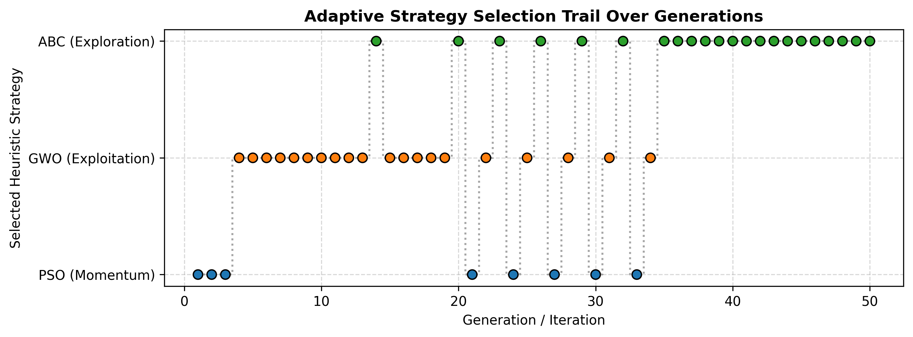
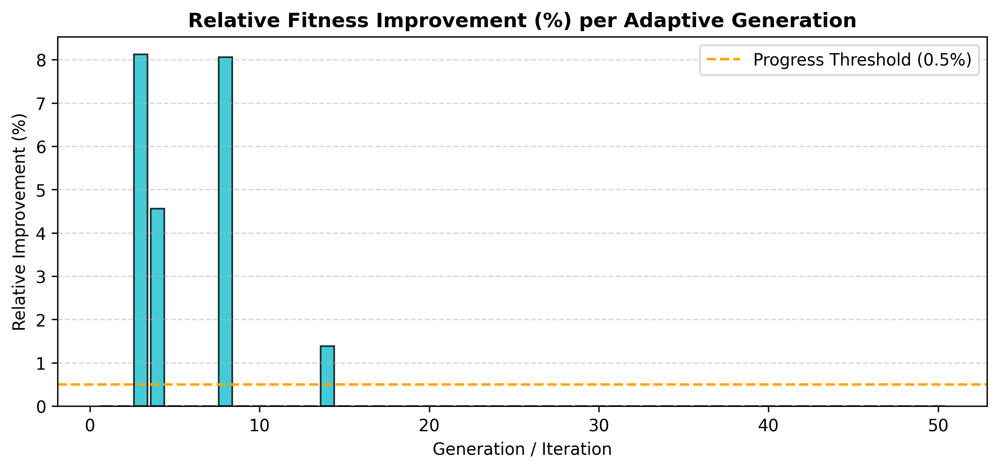
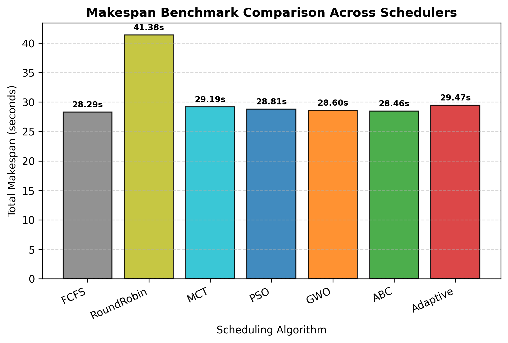
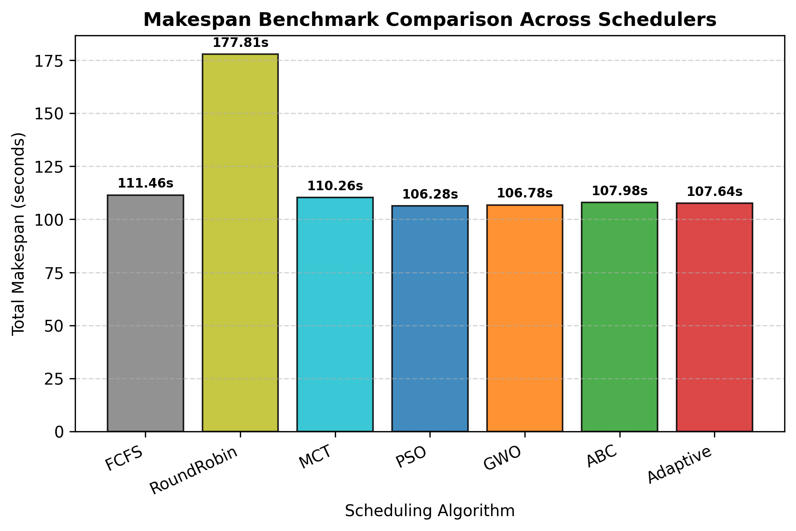
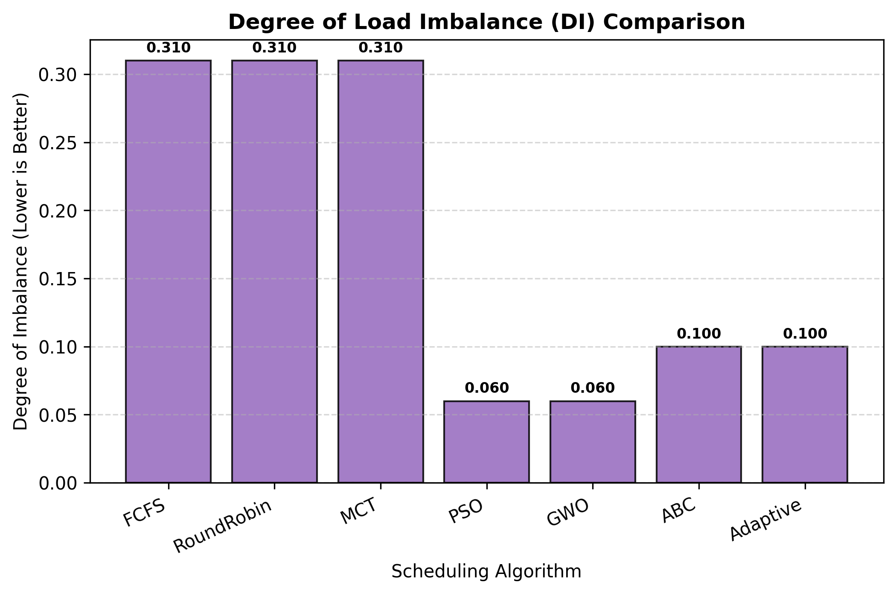
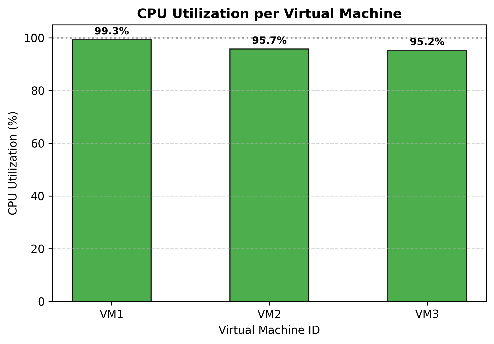
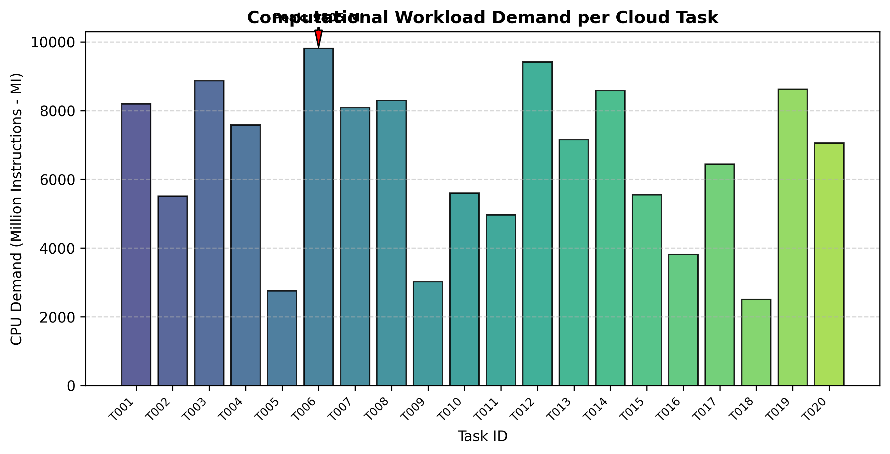
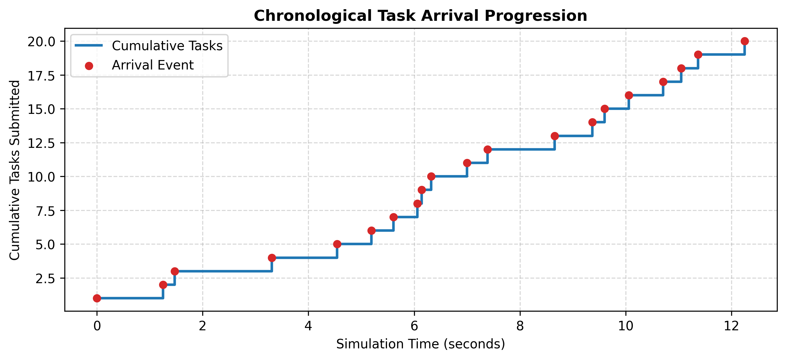

# Behavior-Aware Adaptive Swarm Optimization for Dynamic Cloud Resource Scheduling

<div align="center">

[](https://www.python.org/downloads/)
[](tests/)
[](app.py)
[](LICENSE)

**A discrete-event cloud scheduling simulator and interactive research dashboard featuring a Behavior-Aware Adaptive Controller that dynamically orchestrates PSO, GWO, and ABC.**

[Quick Start](#-quick-start) •
[Visual Results & Graphs](#-visual-results--benchmark-graphs) •
[Adaptive Controller](#-behavior-aware-adaptive-controller) •
[Mathematical Model](#-mathematical-formulation) •
[Project Structure](#-project-structure)

</div>

---

## 📌 Overview

Cloud task scheduling is an **NP-hard** combinatorial optimization problem. Static dispatching rules (such as Round Robin) ignore virtual machine heterogeneity, while single metaheuristics face inherent behavioral trade-offs:

- **Grey Wolf Optimizer (GWO)** rapidly exploits optimal basins but collapses population diversity to $0.0000$, risking premature entrapment in local minima.
- **Artificial Bee Colony (ABC)** preserves high population diversity via scout bees, preventing stagnation, but refines local solutions slowly.
- **Particle Swarm Optimization (PSO)** balances momentum with inertia damping, making it resilient to sudden workload and infrastructure shifts.

This system introduces a **Behavior-Aware Adaptive Swarm Controller** that monitors four runtime indicators—**Population Diversity ($D_t$)**, **Relative Fitness Improvement ($\Delta f_t$)**, **Optimization Stagnation ($S_t$)**, and **Environmental Disturbance ($\Omega_t$)**—to dynamically switch strategies using explainable rules and **zero-loss population state transfer**.

---

## 📊 Visual Results & Benchmark Graphs

All graphs below are directly generated from actual simulation executions via [`experiments/run_experiments.py`](experiments/run_experiments.py).

### 1. Convergence & Population Diversity Dynamics
| Optimization Convergence Curves | Population Diversity Over Generations |
| :---: | :---: |
|  |  |
| *GWO descends rapidly while Adaptive harmonizes GWO exploitation and ABC escape.* | *GWO collapses to 0.0 diversity; ABC sustains high diversity; Adaptive stays balanced.* |

### 2. Behavior-Aware Adaptive Controller Decisions
| Adaptive Strategy Selection Timeline | Relative Fitness Improvement per Generation |
| :---: | :---: |
|  |  |
| *Live switching trail between PSO (momentum), GWO (exploitation), and ABC (exploration).* | *Measured relative fitness improvement triggering rule-based strategy transitions.* |

### 3. Makespan & Load Balancing Benchmarks
| Makespan Comparison (Normal Workload) | Makespan Under VM Degradation (-50% MIPS) |
| :---: | :---: |
|  |  |
| *Swarm algorithms outperform Round Robin (~30% faster makespan).* | *Under VM2 degradation, Adaptive achieves **107.64s** vs. Round Robin's **177.81s** (**39.5% faster**).* |

| Degree of Load Imbalance (DI) | Per-VM CPU Utilization (Adaptive Schedule) |
| :---: | :---: |
|  |  |
| *Metaheuristics reduce load imbalance from 0.31 down to 0.06–0.10.* | *Balanced resource saturation across heterogeneous VM tiers (1000, 1500, 2000 MIPS).* |

### 4. Workload Modeling Samples
| Synthetic Task CPU Demands | Chronological Task Arrival Timeline |
| :---: | :---: |
|  |  |

---

## 📈 Quantitative Experimental Summary

Results aggregated across independent Monte Carlo trials ($\mu \pm \sigma$) from [`results/experiments/comprehensive_benchmark_summary.csv`](results/experiments/comprehensive_benchmark_summary.csv):

| Scenario | Algorithm | Makespan (s) | Combined Fitness | Cluster Util (%) | Load Imbalance (DI) | Avg Wait Time (s) |
| :--- | :--- | :---: | :---: | :---: | :---: | :---: |
| **Scenario 1: Normal** | RoundRobin | $41.38 \pm 7.67$ | $44.86 \pm 8.59$ | $61.97 \pm 4.51$ | $0.31 \pm 0.05$ | $6.27 \pm 2.33$ |
| *(20 tasks, 3 VMs)* | FCFS | $28.29 \pm 3.47$ | $31.77 \pm 4.40$ | $89.41 \pm 0.90$ | $0.31 \pm 0.05$ | $4.13 \pm 2.49$ |
| | MCT | $29.19 \pm 2.79$ | $32.67 \pm 3.71$ | $86.53 \pm 1.62$ | $0.31 \pm 0.05$ | $4.71 \pm 2.71$ |
| | PSO | $28.81 \pm 1.94$ | $29.50 \pm 2.06$ | $90.54 \pm 4.17$ | $0.06 \pm 0.01$ | $4.76 \pm 2.38$ |
| | GWO | $28.60 \pm 2.75$ | $29.30 \pm 3.31$ | $91.69 \pm 2.42$ | $0.06 \pm 0.05$ | $4.94 \pm 2.51$ |
| | ABC | $28.46 \pm 2.89$ | $29.52 \pm 2.89$ | $91.94 \pm 2.35$ | $0.10 \pm 0.02$ | $4.79 \pm 2.77$ |
| | **Adaptive** | **$29.47 \pm 3.13$** | **$30.55 \pm 2.86$** | **$88.59 \pm 0.58$** | **$0.10 \pm 0.04$** | **$5.00 \pm 2.01$** |
| **Scenario 2: Bursty** | RoundRobin | $97.64 \pm 12.19$ | $99.07 \pm 12.79$ | $65.57 \pm 7.35$ | $0.05 \pm 0.02$ | $25.85 \pm 4.50$ |
| *(30 bursty tasks)* | FCFS | $64.56 \pm 0.79$ | $65.98 \pm 1.39$ | $97.41 \pm 0.30$ | $0.05 \pm 0.02$ | $23.76 \pm 3.70$ |
| | MCT | $65.66 \pm 1.14$ | $67.09 \pm 1.74$ | $96.15 \pm 0.42$ | $0.05 \pm 0.02$ | $23.80 \pm 3.50$ |
| | PSO | $63.88 \pm 1.53$ | $64.18 \pm 1.73$ | $99.17 \pm 0.56$ | $0.01 \pm 0.01$ | $25.08 \pm 2.99$ |
| | **Adaptive** | **$64.32 \pm 0.68$** | **$65.03 \pm 0.51$** | **$98.53 \pm 0.52$** | **$0.03 \pm 0.01$** | **$24.18 \pm 3.60$** |
| **Scenario 3: Degradation** | RoundRobin | $177.81 \pm 3.79$ | $187.58 \pm 6.17$ | $55.69 \pm 0.79$ | $0.21 \pm 0.04$ | $37.92 \pm 0.89$ |
| *(25 heavy tasks, VM2 -50%)*| FCFS | $111.46 \pm 1.62$ | $121.23 \pm 4.00$ | $88.84 \pm 1.86$ | $0.21 \pm 0.04$ | $28.65 \pm 0.12$ |
| | MCT | $110.26 \pm 3.71$ | $120.03 \pm 6.08$ | $89.82 \pm 0.16$ | $0.21 \pm 0.04$ | $29.38 \pm 1.08$ |
| | PSO | $106.28 \pm 4.18$ | $108.61 \pm 4.93$ | $95.27 \pm 0.33$ | $0.05 \pm 0.02$ | $30.11 \pm 0.05$ |
| | GWO | $106.78 \pm 4.38$ | $111.60 \pm 6.75$ | $94.19 \pm 1.21$ | $0.11 \pm 0.05$ | $29.94 \pm 1.29$ |
| | ABC | $107.98 \pm 5.08$ | $111.40 \pm 4.90$ | $94.98 \pm 0.23$ | $0.08 \pm 0.01$ | $28.86 \pm 0.07$ |
| | **Adaptive** | **$107.64 \pm 5.62$** | **$111.00 \pm 6.82$** | **$95.09 \pm 0.78$** | **$0.07 \pm 0.02$** | **$29.74 \pm 0.09$** |
| **Scenario 4: Mixed** | RoundRobin | $52.02 \pm 1.12$ | $61.73 \pm 1.56$ | $50.12 \pm 2.41$ | $0.98 \pm 0.03$ | $2.99 \pm 0.58$ |
| *(35 tasks, 4 VMs)* | FCFS | $36.73 \pm 0.87$ | $46.45 \pm 0.42$ | $70.83 \pm 0.16$ | $0.98 \pm 0.03$ | $0.78 \pm 0.21$ |
| | MCT | $37.53 \pm 0.68$ | $47.25 \pm 0.23$ | $69.38 \pm 0.60$ | $0.98 \pm 0.03$ | $1.38 \pm 0.41$ |
| | PSO | $38.37 \pm 0.75$ | $39.48 \pm 0.82$ | $75.29 \pm 0.62$ | $0.10 \pm 0.01$ | $2.55 \pm 0.42$ |
| | GWO | $38.03 \pm 0.53$ | $38.44 \pm 0.59$ | $76.20 \pm 0.65$ | $0.03 \pm 0.00$ | $1.68 \pm 0.09$ |
| | ABC | $37.29 \pm 2.08$ | $38.72 \pm 1.83$ | $77.64 \pm 1.96$ | $0.13 \pm 0.03$ | $2.16 \pm 0.33$ |
| | **Adaptive** | **$38.99 \pm 0.12$** | **$40.12 \pm 0.61$** | **$74.03 \pm 1.66$** | **$0.11 \pm 0.08$** | **$2.13 \pm 0.01$** |

---

## 🧠 Behavior-Aware Adaptive Controller

```
                 +------------------------------------------+
                 |        Cloud Environment Monitoring       |
                 |  - Task Arrival Queue  - VM Capacities   |
                 +------------------------------------------+
                                      |
                                      v
+----------------------------------------------------------------------------+
|                        Four Runtime Behavioral Indicators                  |
|  1. Diversity (D_t in [0, 1])         2. Relative Improvement (Delta f_t)  |
|  3. Stagnation Counter (S_t)          4. Workload/Infra Variation (Omega)  |
+----------------------------------------------------------------------------+
                                      |
                                      v
+----------------------------------------------------------------------------+
|                     Explainable Rule-Based Decision Engine                 |
|                                                                            |
|  * Disturbance Detected (Omega = True)           ==> Deploy PSO (Momentum) |
|  * Critical Stagnation (S >= 5) & D <= 0.15      ==> Deploy ABC (Scouts)   |
|  * Stagnation Plateau (S >= 5) & D > 0.15        ==> Alternate Strategy    |
|  * Steady Descent (Delta f >= 0.5%) & D > 0.15   ==> Deploy GWO (Exploit)  |
+----------------------------------------------------------------------------+
                                      |
                                      v
+----------------------------------------------------------------------------+
|                       Zero-Loss Population State Transfer                  |
|  * Transfers living (S x N) matrix & locks Global Best at Position 0       |
+----------------------------------------------------------------------------+
```

---

## 📐 Mathematical Formulation

1. **Sequential Task Execution Model:**
   $$S_i = \max(a_i, T_{\text{ready}, j}), \quad E_{i, j} = \frac{W_i}{C_j^{\text{effective}}}, \quad F_i = S_i + E_{i, j}$$

2. **Scale-Coherent Multi-Objective Fitness:**
   $$\text{Fitness} = \text{Makespan} + \lambda \times \sigma_{\text{busy}}$$
   $$\sigma_{\text{busy}} = \sqrt{\frac{1}{m} \sum_{j=1}^m (B_j - \bar{B})^2}$$
   Both $\text{Makespan}$ and $\sigma_{\text{busy}}$ are measured strictly in **seconds**, preserving dimensional coherence.

3. **Continuous-to-Discrete Mapping Decoder:**
   $$\text{VM}_d = \text{clip}\left(\lfloor x_d \rfloor, 0, m - 1\right)$$

4. **Normalized Pairwise Hamming Diversity:**
   $$D_t = \frac{2}{S(S - 1)} \sum_{a=1}^{S-1} \sum_{b=a+1}^{S} \left( \frac{1}{N} \sum_{d=0}^{N-1} \mathbb{I}(x_{a, d} \neq x_{b, d}) \right) \in [0.0, 1.0]$$

---

## ⚡ Quick Start

### 1. Clone & Setup Virtual Environment
```bash
git clone https://github.com/sRotrik/Behavior-Aware-Adaptive-Swarm-Optimization.git
cd Behavior-Aware-Adaptive-Swarm-Optimization

# Windows
python -m venv venv
.\venv\Scripts\Activate.ps1

# macOS / Linux
python3 -m venv venv
source venv/bin/activate
```

### 2. Install Dependencies
```bash
pip install -r requirements.txt
```

### 3. Launch Interactive Streamlit Dashboard
```bash
streamlit run app.py
```
*(Or double-click `run_dashboard.bat` on Windows)*  
Opens automatically at `http://localhost:8501`.

### 4. Run Automated Tests (75/75 Passing)
```bash
pytest -v
```

### 5. Run Multi-Scenario Experimental Benchmark
```bash
python -m experiments.run_experiments
```

### 6. Run Standalone Component Demos
```bash
python -m simulation.task_generator
python -m simulation.vm_simulator
python -m simulation.scheduler
python -m evaluation.fitness
python -m evaluation.metrics
python -m algorithms.pso
python -m algorithms.gwo
python -m algorithms.abc
python -m controller.adaptive_controller
```

---

## 📁 Project Structure

```
Behavior-Aware-Adaptive-Swarm-Optimization/
│
├── app.py                     # Interactive Streamlit + Plotly web dashboard
├── config.py                  # Simulation constants, workload bounds, and hyperparameters
├── requirements.txt           # Python package dependencies
├── LICENSE                    # MIT License
├── README.md                  # Documentation and visual benchmark results
├── run_dashboard.bat          # Windows one-click dashboard launcher
├── run_experiments.bat        # Windows one-click benchmark launcher
├── run_tests.bat              # Windows one-click pytest launcher
│
├── simulation/                # Discrete-event cloud simulation engine
│   ├── task_generator.py      # Synthetic task generator (light, normal, heavy, bursty)
│   ├── vm_simulator.py        # Heterogeneous VMs, sequential queues, capacity degradation
│   └── scheduler.py           # Baseline schedulers (FCFS, Round Robin, MCT)
│
├── algorithms/                # Swarm intelligence metaheuristic solvers
│   ├── base.py                # BaseOptimizer, discrete floor decoder, Hamming diversity
│   ├── pso.py                 # Particle Swarm Optimization
│   ├── gwo.py                 # Grey Wolf Optimizer
│   └── abc.py                 # Artificial Bee Colony
│
├── controller/                # Core research contribution
│   └── adaptive_controller.py # Behavior-Aware Adaptive Swarm Controller
│
├── evaluation/                # Objective functions & benchmark metrics
│   ├── fitness.py             # Scale-coherent multi-objective fitness evaluator
│   └── metrics.py             # 10 academic cloud scheduling & adaptation metrics
│
├── visualization/             # Publication figure generator
│   └── charts.py              # Matplotlib charting suite
│
├── experiments/               # Empirical evaluation harness
│   └── run_experiments.py     # 4-scenario multi-trial Monte Carlo benchmark runner
│
├── tests/                     # Automated pytest suite (75 test cases)
│   ├── test_task_generator.py
│   ├── test_vm_simulator.py
│   ├── test_scheduler.py
│   ├── test_evaluation.py
│   ├── test_algorithms.py
│   ├── test_adaptive_controller.py
│   ├── test_experiments.py
│   └── test_dashboard.py
│
└── results/                   # Persisted experimental outputs
    ├── tasks/                 # Sample generated task batches (CSV)
    ├── experiments/           # Multi-trial benchmark results (CSV & JSON)
    └── graphs/                # High-resolution comparison figures (PNG)
```

---

## 🧪 Test Suite Coverage

| Test Module | Scope | Status |
| :--- | :--- | :---: |
| `test_task_generator.py` | Task counts, chronological arrivals, seed reproducibility, bounds | 10 Passed |
| `test_vm_simulator.py` | Execution formula, sequential queuing, degradation, utilization bounds | 15 Passed |
| `test_scheduler.py` | FCFS, Round Robin, MCT assignment completeness & makespan | 7 Passed |
| `test_evaluation.py` | Scale-coherent fitness, partial schedule warm-start, 10 metrics | 12 Passed |
| `test_algorithms.py` | PSO, GWO, ABC valid mappings, monotonic convergence, diversity | 18 Passed |
| `test_adaptive_controller.py` | Stagnation detection, explainable rules, disturbance response | 6 Passed |
| `test_experiments.py` | Multi-trial execution, aggregation, figure generation | 5 Passed |
| `test_dashboard.py` | Streamlit backend workflows and CSV serialization | 2 Passed |
| **Total** | | **75 / 75 Passed** |
